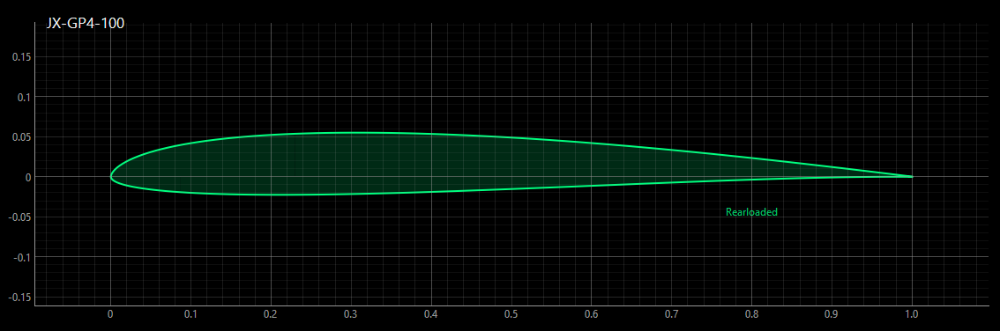
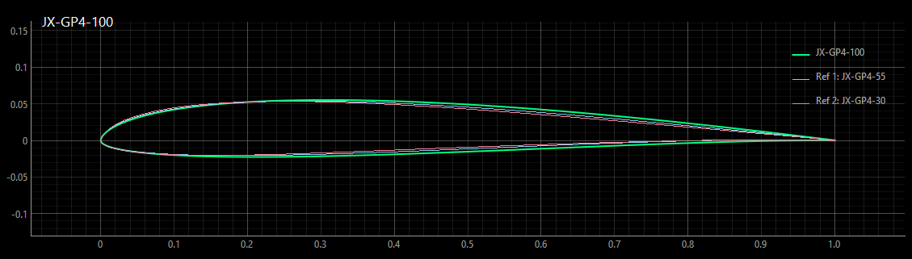
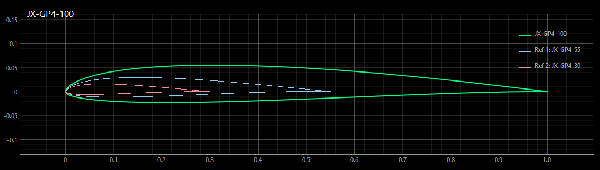
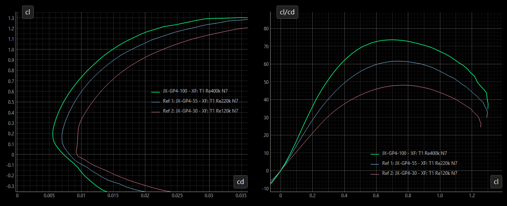
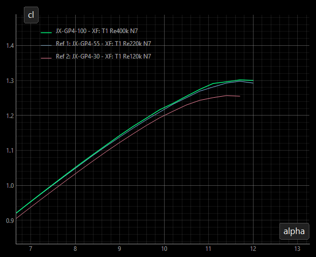

# JX-GP4

JX-GP4 is the fourth revision of the JX-GP airfoil **strak** (a progression of airfoils along a wing). It is designed primarily for F3F slope gliders flown in medium to light conditions. Its all-round characteristics also make it suitable for F3B models and sport gliders.

The family is intended for wingspans of approximately 1.5 to 3.5 m. Use each section at the suggested position along the wing to maintain a consistent lift, drag and pitching-moment distribution. Flaps are recommended to make full use of the design.

The airfoils were designed with [Xoptfoil2](https://github.com/jxjo/Xoptfoil2) and prepared using [AirfoilEditor](https://github.com/jxjo/AirfoilEditor).

### Download

Download the [JX-GP4 airfoil files](JX-GP4.zip). The ZIP contains the three coordinate files: JX-GP4-100, JX-GP4-55 and JX-GP4-30. The individual coordinates and Xfoil polars are also available in this repository.

### Design goals

- Low drag around a lift coefficient (cl) of 0.2, with no flap deflection at medium glide speed
- High maximum angle of attack and maximum lift coefficient (cl_max)
- Useful performance across a broad Reynolds-number range, including lower Reynolds numbers

In flight, the family is intended to provide efficient glide and thermal performance with modest positive flap settings (around +1° to +3°), good acceleration and high-speed capability, and ample lift for tight turns. Actual results depend on the wing, setup and flying conditions.

### Design history

The JX-GP family was developed for the VJX.glide project, an extension of the original VJX for medium to light conditions. The VJX.glide and the original JX-GP design are documented in the [RC-Network project thread](https://www.rc-network.de/threads/projekt-vjx-glide.11961376/).

In 2025, the family was comprehensively revised using Bezier curves to improve geometric quality and to better align zero-lift angle and cl_max across the sections. This became JX-GP3.

JX-GP4 is the 2026 revision. The update slightly improves glide at higher lift coefficients and better aligns the lift curves and cl_max of the JX-GP4-55 and JX-GP4-30 with the JX-GP4-100.

## The airfoil family

The family comprises three airfoils, each optimized for its own Reynolds-number range to provide consistent aerodynamic characteristics along the wing.

The sections shown at their suggested positions on a wing:

### Naming and blending

The number at the end of each airfoil name indicates its suggested chord position as a percentage of the root chord. For example, with a 240 mm root chord, JX-GP4-55 is intended for a section with a chord of about 132 mm.

Intermediate sections can be created by blending airfoils in [AirfoilEditor](https://github.com/jxjo/AirfoilEditor). For example, blending JX-GP4-100 with 33% JX-GP4-55 gives an intermediate section near JX-GP4-85. Check the resulting geometry and aerodynamic performance for the intended wing and Reynolds-number range.

### Section data

Each airfoil was optimized around its design Reynolds number using an Xfoil Type 1 polar with Ncrit = 7. Additional design objectives included performance at approximately half the design Reynolds number.

| Airfoil | Design Re | Approx. Re range | Thickness | Camber | Role |
| :--- | :---: | :---: | :---: | :---: | :--- |
| JX-GP4-100 | 400,000 | 200,000–600,000 | 7.7% at 27% chord | 1.7% at 40% chord | Master/root performance section |
| JX-GP4-55 | 220,000 | 100,000–350,000 | 7.3% at 24% chord | 1.8% at 38% chord | Outer-wing performance section |
| JX-GP4-30 | 120,000 | 50,000–200,000 | 7.3% at 21% chord | 1.8% at 35% chord | Tip section, designed for lift reserve |

As a rough speed reference, a 230 mm chord at Re = 400,000 corresponds to about 25 m/s in typical conditions.

JX-GP4-100 and JX-GP4-55 cover the part of the wing where aerodynamic performance is the primary goal. Particular attention was paid to retaining maximum lift on JX-GP4-55, helping preserve lift reserve on the outer wing and supporting a planform closer to elliptical. JX-GP4-30 has a different priority: it is primarily designed to provide enough lift at the wingtip at high angles of attack. It can also be blended with JX-GP4-55 for smaller gliders.

### Design considerations

The outer sections can operate below Re = 200,000, where laminar separation bubbles become increasingly influential. The upper-surface pressure recovery therefore uses a gentle “bubble ramp.” This approach trades some glide performance at higher Reynolds numbers for more forgiving low-speed behavior and acceleration.

The lower surface has a curvature reversal, producing a rear-loaded section that supports lift at medium and high angles of attack. Rear-loading can move boundary-layer transition forward at low lift, increasing drag in that regime. The amount was balanced against the goal of retaining good acceleration and high-speed performance.

### Polars

The family is designed for fast flying, with minimum drag near cl = 0.2 and similar lift-curve behavior across the sections. The diagrams compare the airfoils at their respective design Reynolds numbers.

In a completed wing, the tip section may reach its maximum lift at a lower aircraft angle of attack because of the local induced flow.

## License

Unless otherwise noted, these files are licensed under the Creative Commons [Attribution-ShareAlike 4.0 International](https://creativecommons.org/licenses/by-sa/4.0/) license (CC BY-SA 4.0).
